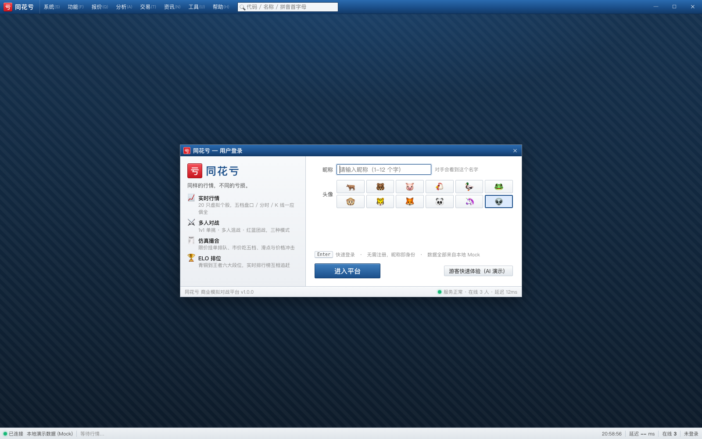
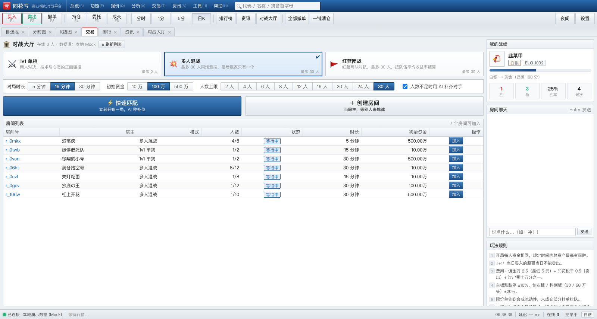
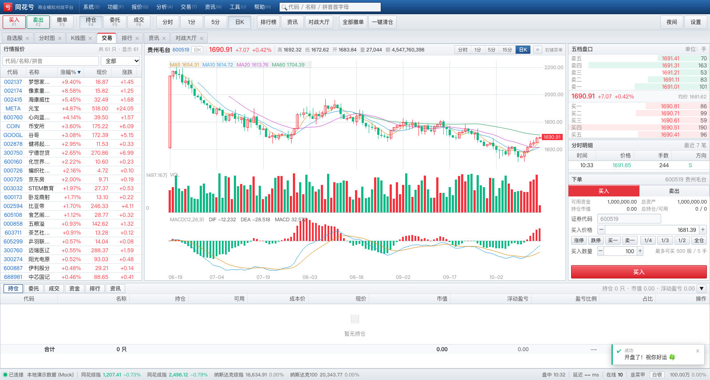
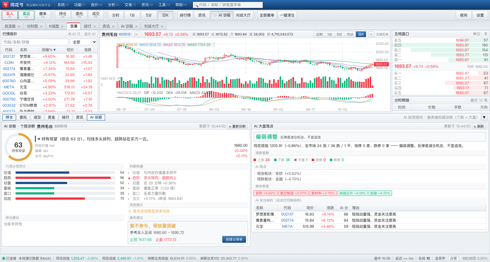
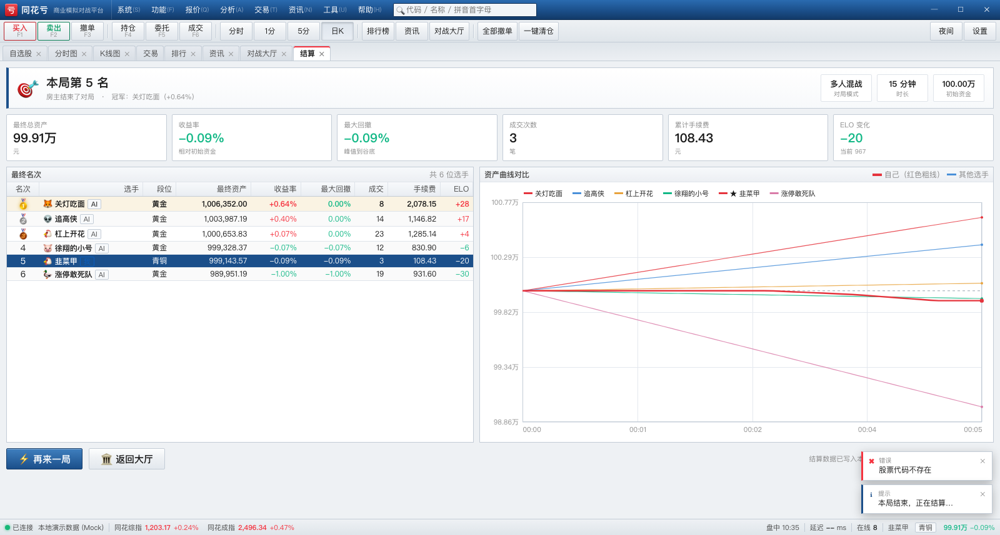
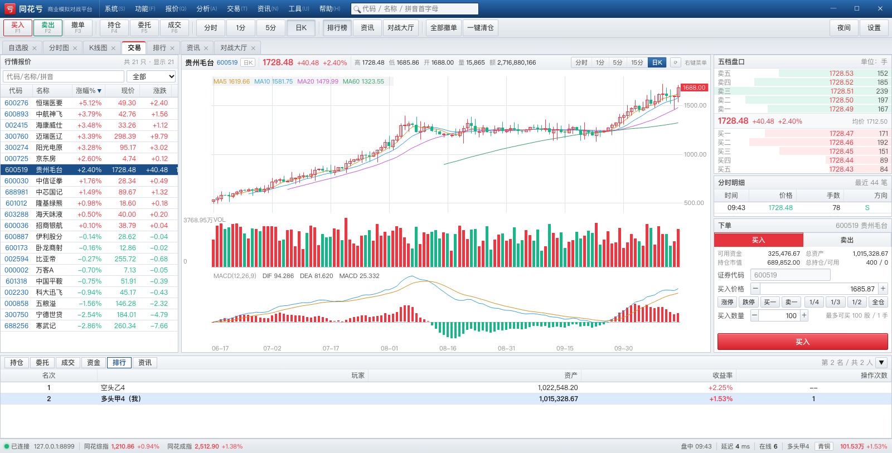

# TongHuaKui (同花亏)

<p>
  
  
  
  
</p>

[中文](README.md) ｜ **English** ｜ [日本語](README.ja.md)

> "Same market, different losses."
> A **multiplayer networked stock-trading business-simulation battle game** that mimics the UI and workflow of **Tonghuashun (同花顺) for Windows**.

* 🖥 **UI** — recreates the desktop feel of the Tonghuashun PC client: deep-blue title bar, menu bar, toolbar, MDI multi-tabs, dense quote table, 5-level order book, order ticket, and an index status bar.
* 📈 **Market** — **61 fictional stocks** = 51 A-shares (including 30 "club-concept" stocks and the meme stock "*Wolong Shangshe*") + 10 Nasdaq stocks; 24 sectors move together, with price limits (A-shares ±10% / ±20%, US ±30%), 5-level depth, tick-by-tick trades, intraday chart, candlesticks + MA/MACD.
* 🌐 **Four indices** — THK Composite (51 A-shares) / THK Component / **Nasdaq Composite** / **Nasdaq-100**, scrolling live in the status bar.
* 🕐 **Pacing** — 1 virtual minute = 5 real seconds; one virtual trading day = the morning session 09:30–11:30 (120 virtual minutes, ~10 real minutes), with a **60-second lunch break** between days (prices frozen, orders queue up). Speed is adjustable live from the ops console.
* 🎛️ **Ops console** (`/admin.html`) — a GUI to **pick a stock → drop an event on it** (government subsidy / regulatory penalty / major-shareholder sell-down / trading halt / earnings blow-up …), plus market-wide events (central-bank hike/cut, national-team rescue, black swan) and **runtime controls** (pause/resume, speed, force lunch break, skip to the next trading day).
* 🤖 **AI investment advisor** (in the spirit of Tonghuashun's "AI Diagnosis"): 0–100 score + 5-tier rating + six sub-scores (valuation / trend / momentum / volume / order book / risk) + rationale + risk warnings + position advice + a one-click order-fill range with stop-loss and take-profit; plus a market-wide AI view (mood, advancers/decliners, leading sectors, AI watchlist). **Scores are computed server-side from the "intrinsic value", so the client cannot forge them.**
* ⚖️ **External counterweights** — every stock has an intrinsic value that players cannot move; the further the price deviates, the harder it is pulled back. Over-pumping attracts contrarian institutional flow (rebalancing, block sells), which drags the price back to a sane range.
* 🎮 **Gameplay** — up to **30 players per room**, identical starting capital, **highest total assets at the end wins**; three modes (1v1 duel, free-for-all, red-vs-blue team battle) with an ELO ladder.
* ⚔️ **Realistic trading rules** — T+1, price limits, commission / stamp duty / transfer fee, limit and market orders, partial fills, cancellation, **resting-order sweep when the market moves through it**, and large-order price impact.
* 🌐 **Cross-platform** — identical behaviour on macOS / Windows / Linux; desktop launchers for Windows and macOS (chrome-less window, feels like a native app).
* 📦 **Zero dependencies** — the server installs **no npm packages** (WebSocket and static file serving are hand-written), and the client needs no build step.

---

## 0. Status (measured, not claimed)

| Module | Status |
|---|---|
| Client UI (login / lobby / trading screen / results) | ✅ 4 views + 7 components |
| Built-in Mock data source (protocol-compliant, runs without a server) | ✅ Done |
| Server (zero-dep: RFC6455 / market engine / matching / rooms / ELO / persistence) | ✅ Done |
| Real multiplayer (2 real browsers + real server in the same match) | ✅ 24/24 assertions |
| Windows deployment (launcher / auto-start / firewall) | ✅ See `docs/DEPLOY-WINDOWS.md` |

### One-command full verification

```bash
bash tools/test-all.sh
```

Runs 5 suites, **344 assertions** in total:

| # | Test | Assertions | Covers |
|---|---|---|---|
| 1 | `server/test/market.test.js` | 48 | Price limits / depth / turnover / VWAP / book merging / indices / intrinsic value |
| 2 | `server/test/engine.test.js` | 29 | Frozen-funds conservation / player-to-player crossing / fees to the cent / order cap / T+1 / **resting-order sweep** |
| 3 | `server/test/ai.test.js` | 51 | AI diagnosis structure / valuation direction / position advice / all 61 stocks / market view |
| 4 | `server/test/e2e.js` | 192 | Real WS, two clients: create room → start → order → T+1 → cancel → reconnect → quick match |
| 5 | `tools/duel.mjs` | 24 | Two **real browsers** in the same match (depth shape, merging, settlement) |

Run them individually:

```bash
node server/test/market.test.js
node server/test/engine.test.js
node server/test/ai.test.js
node server/test/e2e.js
node tools/duel.mjs --port 8899     # server must be running first
```

---

## Screenshots

| Login | Lobby |
|---|---|
|  |  |

| Trading screen (Tonghuashun-style MDI) | AI diagnosis |
|---|---|
|  |  |

| Results · equity curves | Multiplayer ranking |
|---|---|
|  |  |

> There is also an **ops console** (`/admin.html`): pick a stock graphically, drop policy/incident events on it, and pause, re-time, force a lunch break, or skip a trading day.

---

## 1. Quick start

### Windows

```bat
:: 1. Install Node.js 20 LTS or newer (https://nodejs.org/), tick "Add to PATH"
:: 2. Double-click either file:
tools\desktop-windows.bat     :: starts the server + opens a chrome-less client window (recommended)
tools\start-windows.bat       :: server only (console window)
```

### macOS

```bash
# 1. Install Node.js (brew install node, or the official pkg)
# 2. Double-click tools/desktop-macos.command
#    If macOS refuses to open it, run once:
chmod +x tools/desktop-macos.command tools/start.sh
```

### macOS desktop app (.app, native window)

```bash
bash tools/build-macos-app.sh          # output: dist/同花亏.app (~120 MB, embeds Node)
open "dist/同花亏.app"                  # or just double-click it in Finder
```

* Opens a native window with **WKWebView** (no Chrome / Electron / npm packages)
* **Node runtime is embedded** → the target machine does not need Node installed
* On launch it starts its own server (port 8899) and reaps the child process on quit
* If something is already listening on 8899, it attaches to it instead of conflicting
* Data lives in `~/Library/Application Support/TongHuaKui/`, logs in `~/Library/Logs/TongHuaKui/server.log`
* If Gatekeeper blocks it the first time: right-click → Open, or `xattr -dr com.apple.quarantine "dist/同花亏.app"`
* To open only the client while a server already runs: menu "显示 → 重新启动服务端"

> To drop the embedded Node: `BUNDLE_NODE=0 bash tools/build-macos-app.sh`

### Any platform (CLI)

```bash
node server/server.js              # defaults to 0.0.0.0:8899
node server/server.js --port 9000  # different port
node server/server.js --open       # open the browser on start
```

Then open **http://127.0.0.1:8899**. Other machines on the LAN can join via `http://<your-ip>:8899`.

### Front-end-only preview (no server needed)

```bash
# Serve client/ with any static server
cd client && python3 -m http.server 8899
# Open http://127.0.0.1:8899/index.html?mock=1&view=trade&auto=1
```

**Data-source strategy**: the client connects to a **real local server** by default; if nothing answers within 2.5 s
(e.g. you only started a static server to look at the UI), it **falls back** to the built-in demo data
(`client/js/mock.js`, fully protocol-compliant). You can also force it:

| URL parameter | Effect |
|---|---|
| `?real=1` | Force a real server (error out instead of falling back) |
| `?mock=1` | Force the built-in demo data (no server at all) |
| `?view=trade&auto=1` | Jump straight to the trading screen and auto-start a match (for screenshots/demos) |

---

## 2. Repository layout

```
tonghuakui/
├── PROTOCOL.md          Wire protocol (the single contract between client and server)
├── DESIGN.md            Architecture, module interfaces, UI conventions
├── client/              Pure static web client (ES modules + Canvas, no build)
│   ├── index.html       Desktop shell skeleton (title bar / menus / toolbar / tabs / status bar)
│   ├── css/             theme (design system) / app (shell) / trade / chart / views
│   └── js/
│       ├── main.js      Boot, routing, shell behaviour, protocol dispatch
│       ├── net.js       Real WebSocket client (auto-reconnect + request/response)
│       ├── mock.js      MockNet: protocol-compliant local fake server
│       ├── store.js     Global state
│       ├── util.js      Formatting / DOM / dialogs
│       ├── views/       login · lobby · trade · result
│       └── components/  chart · chart-panel · quote-list · depth · order-form · tables · toast
├── server/              Node.js server (zero npm dependencies)
│   ├── server.js        Entry point (HTTP + static + WebSocket + lobby)
│   └── src/             ws · static · market · news · engine · portfolio · bot
│                        room · lobby · net · elo · store · config · util
├── tools/               Launchers (Windows / macOS), screenshot helpers
├── docs/                Deployment and gameplay guides
└── data/                Runtime data (store.json, generated on first run)
```

---

## 3. Rules (summary)

| Item | Rule |
|---|---|
| Winning | Highest total assets at the end; team mode uses average team return |
| T+1 | Shares bought today cannot be sold today |
| Price limits | Main board ±10%, ChiNext/STAR (`30`/`68` prefix) ±20% |
| Commission | 0.25‰ of notional, minimum ¥5 |
| Stamp duty | 0.5‰ of sell notional (sells only) |
| Transfer fee | 0.01‰ of notional (both sides) |
| Matching | Limit orders first consume synthetic market liquidity (with slippage), then match other players' resting orders by price/time priority. Market orders sweep the opposite five levels; any remainder is cancelled |
| Price impact | Large aggressive fills move the price — the real cost of size |
| Virtual clock | **5 real seconds = 1 virtual minute**; 120 virtual minutes = 1 trading day (morning session 09:30–11:30) with a 60-second lunch break; adjustable live from the console |
| Tiers | Bronze < Silver < Gold < Platinum < Diamond < King (ELO) |

---

## 4. Keyboard shortcuts

`F1` buy · `F2` sell · `F3` cancel · `F4` positions · `F5` orders · `F6` trades ·
`B`/`S` switch side · `↑`/`↓` change stock · `Enter` submit · `Esc` close dialog ·
`Ctrl+K` global search · `Ctrl+D` dark mode · `F11` fullscreen

---

## 5. Documentation

* [PROTOCOL.md](PROTOCOL.md) — wire protocol between client and server
* [DESIGN.md](DESIGN.md) — architecture and module interfaces
* [docs/DEPLOY-WINDOWS.md](docs/DEPLOY-WINDOWS.md) — Windows Server deployment (incl. auto-start)
* [docs/USER-GUIDE.md](docs/USER-GUIDE.md) — how to play (Chinese)
* [docs/DEPLOY-LINUX.md](docs/DEPLOY-LINUX.md) — Linux + domain + HTTPS/WSS deployment (nginx / systemd / certbot)
* [NOTICE.md](NOTICE.md) — **third-party code and asset notice** (zero dependencies, no third-party libraries)
* [LICENSE](LICENSE) — MIT

> ⚠️ Disclaimer: every stock code, company name, quote and news item in this project is **fictional**. It is made for learning and entertainment only, has nothing to do with real markets, and is **not investment advice**. "Tonghuashun (同花顺)" is a trademark of its owner; this project is a stylistic homage for study and is not affiliated with it.

## Contributors

- [Inkpaper-mz](https://github.com/Inkpaper-Mz) — author & maintainer
- [DeepSeek](https://github.com/deepseek-ai) — AI pair programmer (architecture, implementation, debugging, docs)
