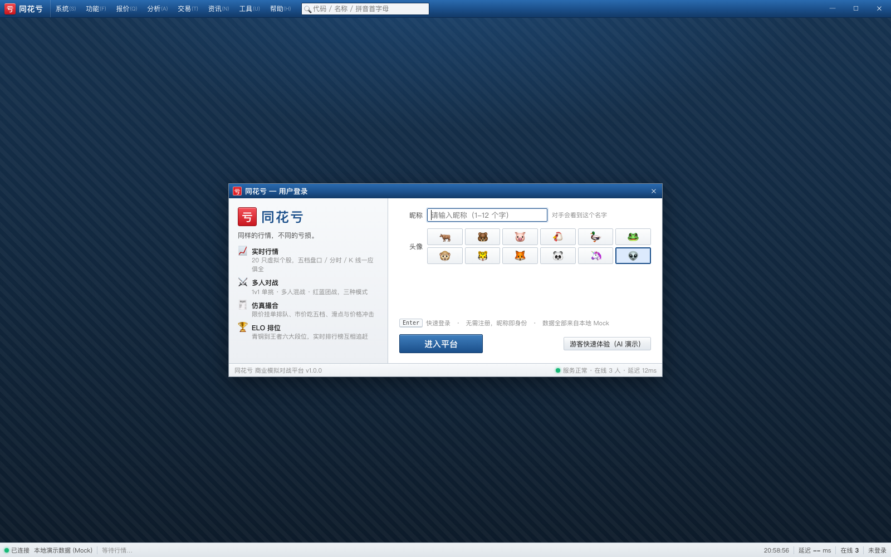
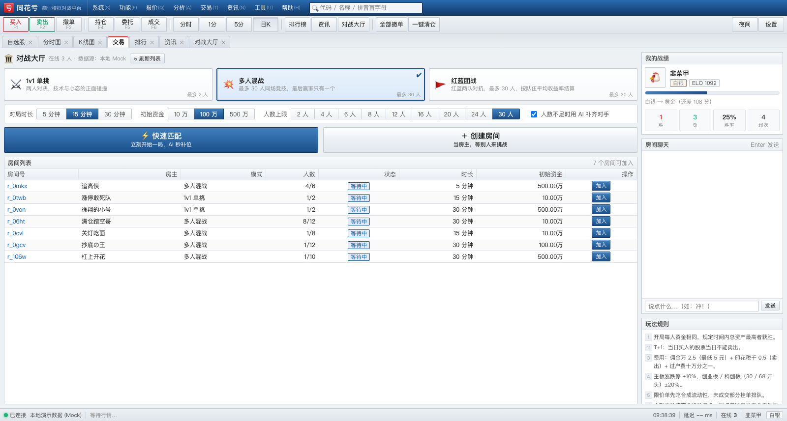
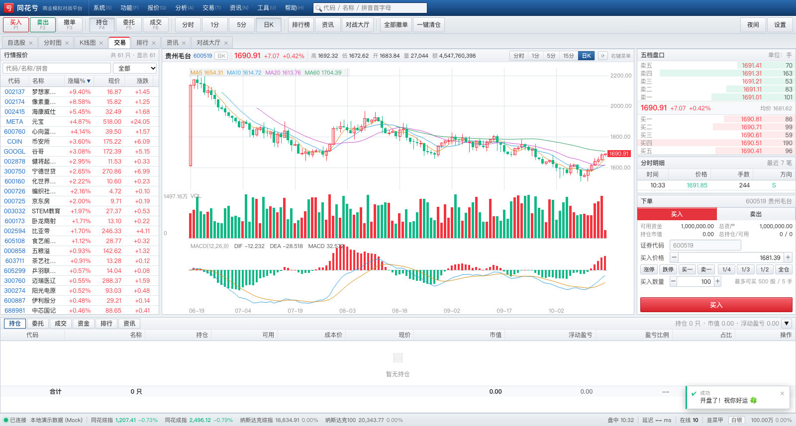
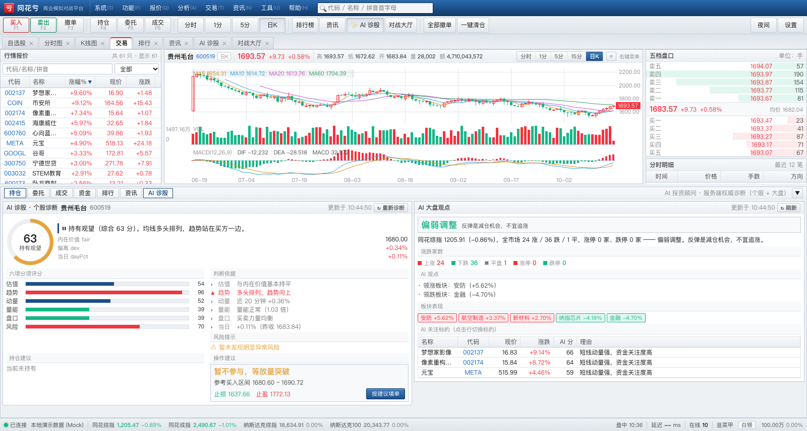
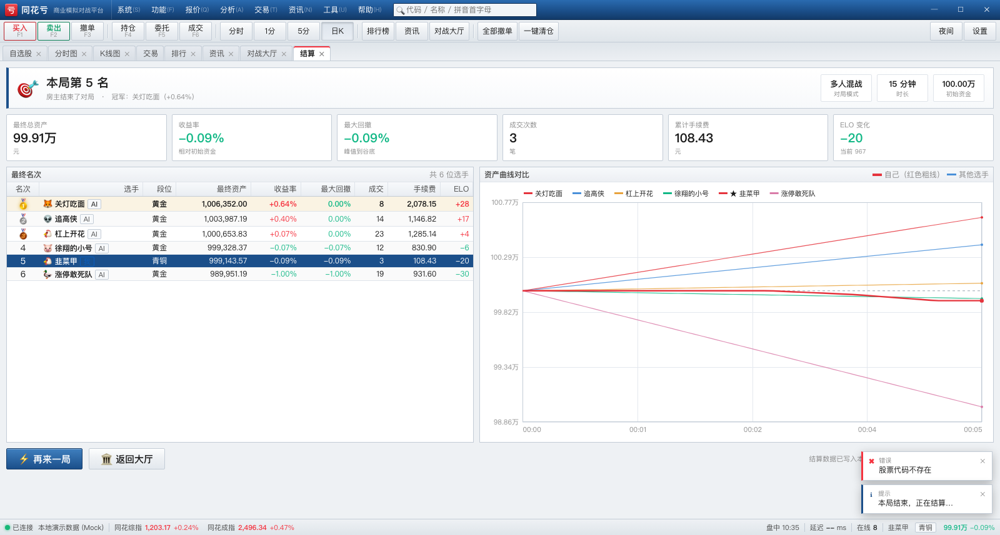
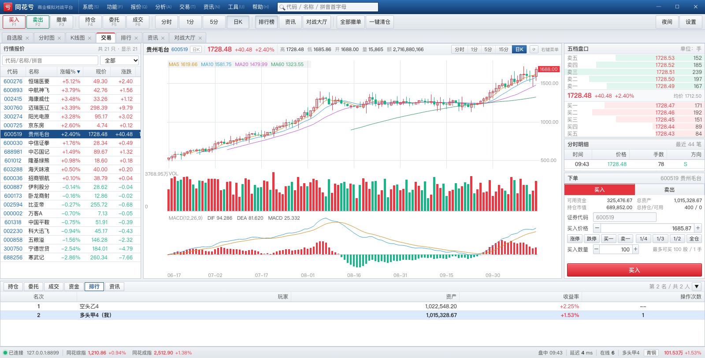

# 同花亏 ・ TongHuaKui

<p>
  
  
  
  
</p>

[中文](README.md) ｜ [English](README.en.md) ｜ **日本語**

> 「同じ相場、違う損失。」
> **Windows 版 同花順（トンファシュン）** の画面と操作感を再現した、**オンライン対戦型の株式トレード・ビジネスシミュレーションゲーム**です。

* 🖥 **UI** — 同花順 PC クライアントの質感を再現：濃紺のタイトルバー、メニューバー、ツールバー、MDI マルチタブ、高密度の銘柄一覧、5 本値の板情報、注文パネル、指数を表示するステータスバー。
* 📈 **相場** — **架空の銘柄 61 本** = A 株 51 本（30 本の「サークル概念株」と妖株「臥龍商射」を含む）＋ナスダック 10 本。24 セクターが連動し、値幅制限（A 株 ±10%/±20%、米株 ±30%）、5 本値、約定履歴、分足チャート、ローソク足 + MA/MACD を備えます。
* 🌐 **4 つの指数** — 同花総合指数（A 株 51 本）/ 同花成分指数 / **ナスダック総合指数** / **ナスダック 100** がステータスバーにリアルタイム表示されます。
* 🕐 **時間の進み方** — 仮想 1 分 = 実時間 5 秒。仮想 1 取引日 = 前場 09:30–11:30（仮想 120 分 ≒ 実時間 10 分）で、取引日の間には **60 秒の昼休み**（相場は停止、注文は待機）。速度は管理コンソールから随時変更できます。
* 🎛️ **運用コンソール**（`/admin.html`）— **銘柄を選んで → その銘柄にイベントを投入**できる GUI（政府補助金 / 監督処分 / 大株主の売却 / 売買停止 / 業績ショック など）、市場全体のイベント（中央銀行の利上げ・利下げ、国家隊の市場支持、ブラック・スワン）、さらに**実行時制御**（一時停止／再開、速度変更、強制昼休み、翌取引日へスキップ）を備えます。
* 🤖 **AI 投資アドバイザー**（同花順の「AI 診断」風）：0〜100 の総合スコア＋5 段階評価＋6 項目の内訳（バリュエーション／トレンド／モメンタム／出来高／板情報／リスク）＋根拠＋リスク警告＋保有銘柄への助言＋ワンクリックで注文に反映できる売買レンジ・損切り・利確。さらに市場全体の AI 見解（地合い、値上がり／値下がり銘柄数、主導セクター、AI 注目銘柄）も表示します。**スコアはサーバー側が「本源的価値」から算出するため、クライアント側で偽装できません。**
* ⚖️ **外部からの抑制力** — 各銘柄にはプレイヤーが動かせない「本源的価値」があり、価格が離れるほど強く引き戻されます。買い上がりすぎると、機関のリバランスや大株主の売却といった逆向きの外部注文が発生し、価格は妥当な範囲に戻されます。
* 🎮 **遊び方** — **1 ルーム最大 30 人**が同じ初期資金で対戦し、**制限時間終了時に総資産が最も多い人が勝ち**。1v1 タイマン／多人乱戦／紅藍団体戦の 3 モードと ELO 段位を用意しています。
* ⚔️ **リアルな取引ルール** — T+1、値幅制限、手数料／印紙税／名義変更料、指値・成行注文、部分約定、注文取消、**相場が指値を追い越した際の待機注文の自動約定（スイープ）**、大口注文による価格インパクト。
* 🌐 **クロスプラットフォーム** — macOS / Windows / Linux で同じ動作。Windows と macOS にはデスクトップランチャー（アドレスバーのないネイティブ風ウィンドウ）を用意しています。
* 📦 **依存ゼロ** — サーバーは **npm パッケージを一切使いません**（WebSocket と静的配信は自前実装）。クライアントはビルド不要です。

---

## 0. 現状（実測ベース）

| モジュール | 状態 |
|---|---|
| クライアント UI（ログイン／ロビー／取引画面／結果画面） | ✅ 4 ビュー + 7 コンポーネント |
| 内蔵 Mock データソース（プロトコル準拠、サーバー不要で動作） | ✅ 完成 |
| サーバー（依存ゼロ：RFC6455／相場エンジン／板寄せ／ルーム対戦／ELO／永続化） | ✅ 完成 |
| 実際のオンライン対戦（実ブラウザ 2 つ＋実サーバーで同一試合） | ✅ 24/24 アサーション |
| Windows への配備（起動スクリプト／自動起動／ファイアウォール） | ✅ `docs/DEPLOY-WINDOWS.md` 参照 |

### ワンコマンドで全検証

```bash
bash tools/test-all.sh
```

5 スイート・**合計 344 アサーション**を順に実行します：

| # | テスト | 件数 | 対象 |
|---|---|---|---|
| 1 | `server/test/market.test.js` | 48 | 値幅制限／板／売買代金／平均価格／板の併合／指数／本源的価値 |
| 2 | `server/test/engine.test.js` | 29 | 凍結資金の保存則／プレイヤー間の交差約定／手数料（円単位）／注文数上限／T+1／**待機注文のスイープ** |
| 3 | `server/test/ai.test.js` | 51 | AI 診断の構造／バリュエーションの向き／保有助言／61 銘柄の網羅／市場見解 |
| 4 | `server/test/e2e.js` | 192 | 実 WS の 2 クライアント：ルーム作成→開始→発注→T+1→取消→再接続→クイックマッチ |
| 5 | `tools/duel.mjs` | 24 | **実ブラウザ 2 つ**の同一試合（板の形・併合・精算） |

個別に実行する場合：

```bash
node server/test/market.test.js
node server/test/engine.test.js
node server/test/ai.test.js
node server/test/e2e.js
node tools/duel.mjs --port 8899     # 先にサーバーを起動しておく
```

---

## スクリーンショット

| ログイン | 対戦ロビー |
|---|---|
|  |  |

| 取引画面（同花順風 MDI） | AI 診断 |
|---|---|
|  |  |

| 結果・資産曲線の比較 | オンライン対戦ランキング |
|---|---|
|  |  |

> ほかに**運用コンソール**（`/admin.html`）もあります：GUI で銘柄を選んで政策／突发事件を投入し、一時停止・速度変更・強制昼休み・取引日スキップができます。

---

## 1. クイックスタート

### Windows

```bat
:: 1. Node.js 20 LTS 以降をインストール（https://nodejs.org/、「Add to PATH」にチェック）
:: 2. 次のいずれかをダブルクリック：
tools\desktop-windows.bat     :: サーバー起動＋アドレスバーのないクライアント窓（推奨）
tools\start-windows.bat       :: サーバーのみ（コンソール窓）
```

### macOS

```bash
# 1. Node.js をインストール（brew install node、または公式 pkg）
# 2. tools/desktop-macos.command をダブルクリック
#    「開けません」と出る場合は一度だけ実行：
chmod +x tools/desktop-macos.command tools/start.sh
```

### macOS デスクトップアプリ（.app、ネイティブウィンドウ）

```bash
bash tools/build-macos-app.sh          # 生成物：dist/同花亏.app（約 120MB、Node 同梱）
open "dist/同花亏.app"                  # または Finder からダブルクリック
```

* システムの **WKWebView** でウィンドウを開きます（Chrome / Electron / npm パッケージ不要）
* **Node ランタイムを同梱** → 実行先に Node を入れる必要はありません
* 起動時に自分でサーバー（8899）を立ち上げ、終了時に子プロセスを回収します
* 8899 で既に何かが動いている場合は、衝突せずそれに接続します
* データは `~/Library/Application Support/TongHuaKui/`、ログは `~/Library/Logs/TongHuaKui/server.log`
* 初回に Gatekeeper で止められたら：右クリック → 開く、または `xattr -dr com.apple.quarantine "dist/同花亏.app"`
* 8899 でサーバーが動いている状態でクライアントだけ開く：メニュー「表示 → サーバーを再起動」

> 同梱 Node を外したい場合：`BUNDLE_NODE=0 bash tools/build-macos-app.sh`

### 任意のプラットフォーム（CLI）

```bash
node server/server.js              # 既定は 0.0.0.0:8899
node server/server.js --port 9000  # ポート変更
node server/server.js --open       # 起動後にブラウザを開く
```

ブラウザで **http://127.0.0.1:8899** を開きます。LAN 内の他のマシンは `http://<自分の IP>:8899` で参加できます。

### フロントエンドのみのプレビュー（サーバー不要）

```bash
# client/ を任意の静的サーバーで配信
cd client && python3 -m http.server 8899
# http://127.0.0.1:8899/index.html?mock=1&view=trade&auto=1 を開く
```

**データソースの戦略**：クライアントは既定で**ローカルの実サーバー**に接続します。2.5 秒以内に応答がなければ
（例：UI だけ見るために静的サーバーを立てた場合）、内蔵のデモデータ（`client/js/mock.js`、プロトコル完全準拠）へ
**自動的にフォールバック**します。URL パラメータで強制もできます：

| パラメータ | 動作 |
|---|---|
| `?real=1` | 実サーバーに強制接続（繋がらなければエラー、フォールバックしない） |
| `?mock=1` | 内蔵デモデータを強制（サーバー一切不要） |
| `?view=trade&auto=1` | 取引画面へ直行して自動で試合開始（スクリーンショット／デモ用） |

---

## 2. ディレクトリ構成

```
tonghuakui/
├── PROTOCOL.md          通信プロトコル（クライアント／サーバー間の唯一の契約）
├── DESIGN.md            アーキテクチャ、モジュールインターフェース、UI 規約
├── client/              純静的 Web クライアント（ES モジュール + Canvas、ビルド不要）
│   ├── index.html       デスクトップシェルの骨組み（タイトルバー／メニュー／ツールバー／タブ／ステータスバー）
│   ├── css/             theme（デザインシステム）／app（シェル）／trade／chart／views
│   └── js/
│       ├── main.js      起動、ルーティング、シェル動作、プロトコル分配
│       ├── net.js       実 WebSocket クライアント（自動再接続＋リクエスト応答）
│       ├── mock.js      MockNet：プロトコル準拠のローカル擬似サーバー
│       ├── store.js     グローバル状態
│       ├── util.js      整形／DOM／ダイアログ
│       ├── views/       login · lobby · trade · result
│       └── components/  chart · chart-panel · quote-list · depth · order-form · tables · toast
├── server/              Node.js サーバー（npm 依存ゼロ）
│   ├── server.js        エントリ（HTTP + 静的配信 + WebSocket + ロビー）
│   └── src/             ws · static · market · news · engine · portfolio · bot
│                        room · lobby · net · elo · store · config · util
├── tools/               ランチャー（Windows / macOS）、スクリーンショット補助
├── docs/                配備と遊び方のドキュメント
└── data/                実行時データ（store.json、初回起動時に生成）
```

---

## 3. ルール（抜粋）

| 項目 | ルール |
|---|---|
| 勝敗 | 終了時の総資産が最も多い人が勝ち。団体戦はチームの平均リターンで判定 |
| T+1 | 当日買った株は当日売れません |
| 値幅制限 | メインボード ±10%、創業板／科創板（`30`/`68` で始まる）±20% |
| 手数料 | 約定代金 × 0.25‰、最低 5 元 |
| 印紙税 | 売却代金 × 0.5‰（売却時のみ） |
| 名義変更料 | 約定代金 × 0.01‰（売買双方） |
| 板寄せ | 指値注文はまず合成流動性を消費（スリッページあり）、その後ほかのプレイヤーの待機注文と価格優先・時間優先で約定。成行注文は相手側 5 本値を消費し、残りは自動取消 |
| 価格インパクト | 大口の積極約定は株価を動かします（規模の実コスト） |
| 仮想時計 | **実時間 5 秒 = 仮想 1 分**。仮想 120 分 = 1 取引日（前場 09:30–11:30）、間に 60 秒の昼休み。コンソールから随時変更可 |
| 段位 | 青銅 < 白銀 < 黄金 < 白金 < ダイヤ < 王者（ELO） |

---

## 4. キーボードショートカット

`F1` 買い · `F2` 売り · `F3` 注文取消 · `F4` 保有銘柄 · `F5` 注文一覧 · `F6` 約定一覧 ·
`B`/`S` 売買方向の切替 · `↑`/`↓` 銘柄の切替 · `Enter` 発注 · `Esc` ダイアログを閉じる ·
`Ctrl+K` 全体検索 · `Ctrl+D` ダークモード · `F11` 全画面

---

## 5. ドキュメント

* [PROTOCOL.md](PROTOCOL.md) — クライアント／サーバー間の通信プロトコル
* [DESIGN.md](DESIGN.md) — アーキテクチャとモジュールインターフェース
* [docs/DEPLOY-WINDOWS.md](docs/DEPLOY-WINDOWS.md) — Windows Server への配備（自動起動を含む）
* [docs/USER-GUIDE.md](docs/USER-GUIDE.md) — 遊び方ガイド（中国語）
* [docs/DEPLOY-LINUX.md](docs/DEPLOY-LINUX.md) — Linux + ドメイン + HTTPS/WSS 配備（nginx / systemd / certbot）
* [NOTICE.md](NOTICE.md) — **サードパーティのコード・素材に関する声明**（依存ゼロ、サードパーティ製ライブラリ未使用）
* [LICENSE](LICENSE) — MIT

> ⚠️ 免責事項：本プロジェクトに登場する銘柄コード、社名、相場、ニュースはすべて**架空**です。学習と娯楽のみを目的としており、実在の市場とは無関係で、**投資助言ではありません**。「同花順」はその権利者の商標です。本プロジェクトは学習目的で画面の雰囲気を模したものであり、同社とは一切関係ありません。
