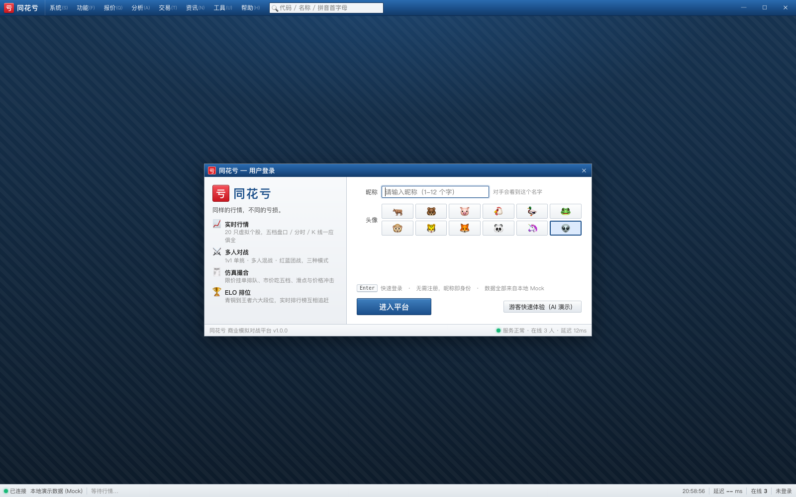
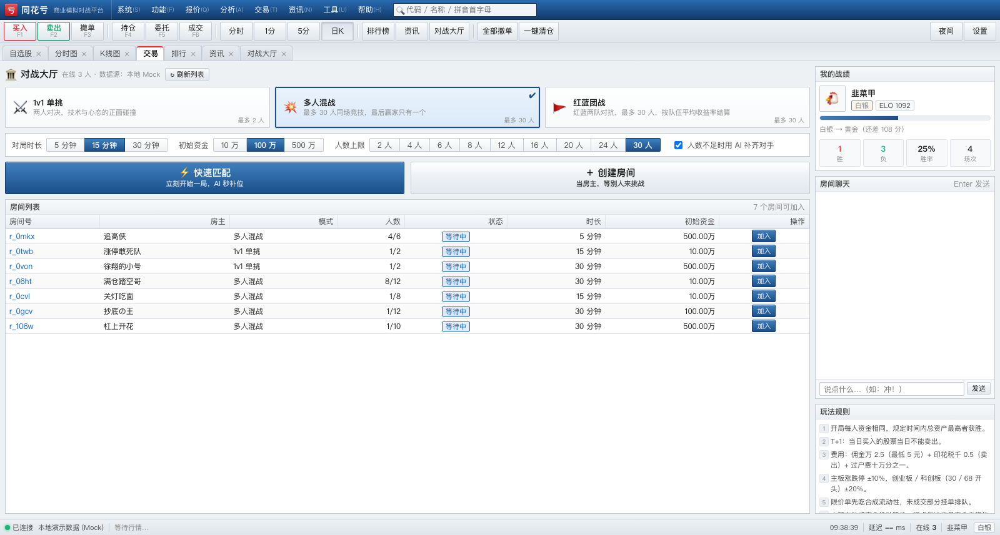
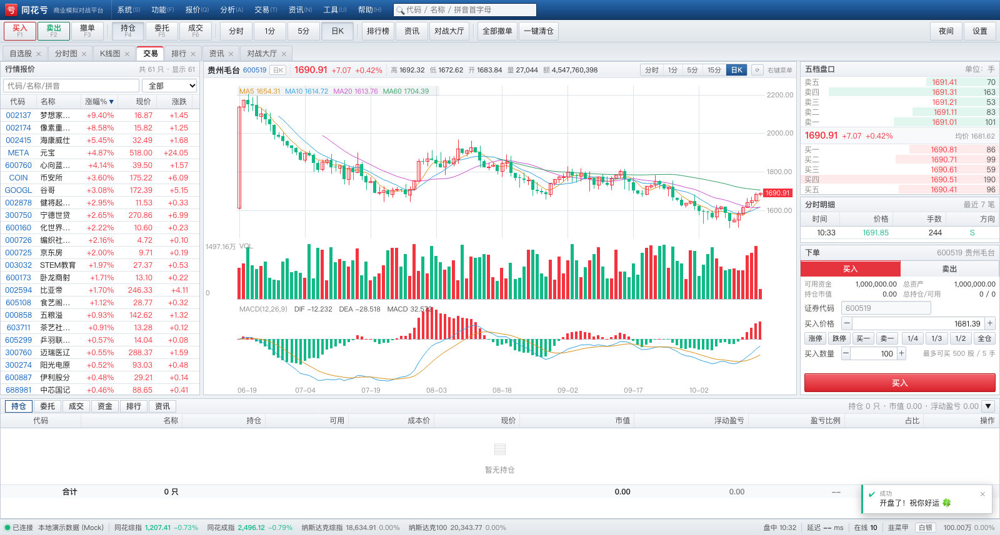
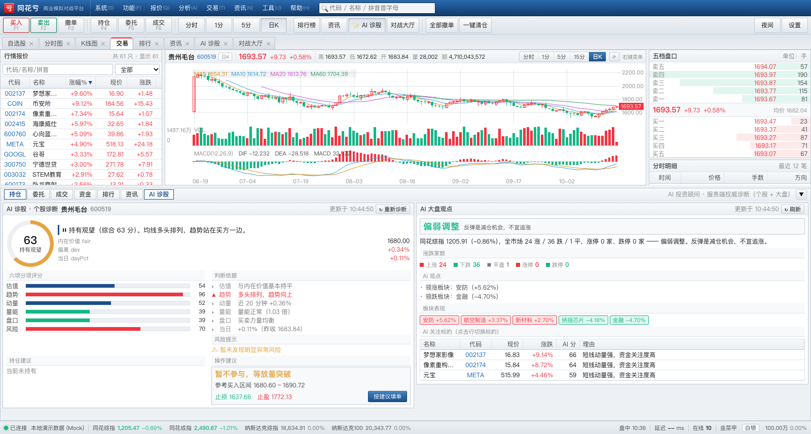
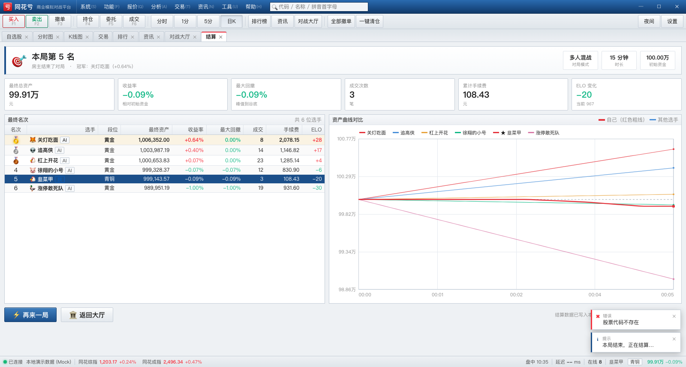
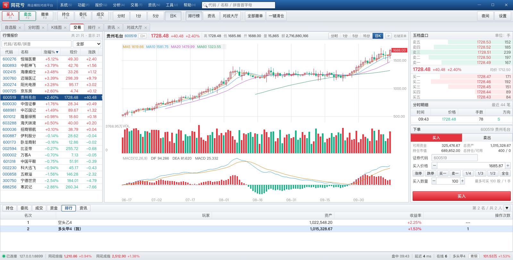

# 同花亏 · TongHuaKui

<p>
  
  
  
  
</p>

> 「同样的行情，不同的亏损。」
> 一个模仿 **Windows 完全版同花顺** 界面与操作习惯的 **多人联网股票交易商业模拟对战游戏**。

* 🖥 **界面**：还原同花顺 PC 客户端的桌面质感 —— 深蓝标题栏、菜单栏、工具栏、MDI 多标签页、密集行情表、五档盘口、下单面板、状态栏大盘指数。
* 📈 **行情**：**61 只虚构股票** = 51 只 A 股（含 30 只「社团概念股」与妖股「卧龙商射」）+ 10 只纳斯达克股；24 个板块联动、涨跌停（A 股 ±10%/±20%，美股 ±30%）、五档盘口、逐笔成交、分时图、K 线 + MA/MACD。
* 🌐 **四大指数**：同花综指（51 只 A 股）/ 同花成指 / **纳斯达克综指** / **纳斯达克100**，状态栏实时滚动。
* 🕐 **节奏**：1 个虚拟分钟 = 5 秒真实时间；一个虚拟交易日 = 上午盘 09:30–11:30（120 分钟，约 10 分钟真实时间），交易日之间有 **1 分钟午间休市**（行情冻结、挂单排队）。速度可由运维控制台实时调整。
* 🎛️ **运维控制台**（`/admin.html`）：图形界面**选股票 → 对它投放事件**（政府补贴 / 监管处罚 / 大股东减持 / 停牌复牌 / 业绩暴雷…），以及全市场事件（央行加息降息、国家队救市、黑天鹅）与**运行时控制**（暂停/继续、调速、强制休市、跳到下一交易日）。
* 🤖 **AI 投资顾问**（同花顺「AI 诊股」风格）：0~100 综合评分 + 五档评级 + 六维分项（估值/趋势/动量/量能/盘口/风险）+ 判断依据 + 风险提示 + 持仓建议 + 可一键填单的买卖区间/止损止盈；另有大盘 AI 观点（市场情绪、涨跌家数、领涨板块、AI 关注标的）。**评分由服务端基于「内在价值」计算，客户端无法伪造**。
* ⚖️ **外部制衡**：每股有不受玩家影响的「内在价值」，偏离越远回拉越强；炒过头会招来机构调仓 / 大股东减持等反向外部盘，价格会被消化回合理区间。
* 🎮 **玩法**：**单房间最多 30 人**同场竞技，起始资金相同，规定时间内 **总资产最高者获胜**；有 1v1 单挑、多人混战、红蓝团战三种模式，ELO 段位赛。
* ⚔️ **真实交易规则**：T+1、涨跌停、佣金/印花税/过户费、限价/市价单、部分成交、撤单、**大单价格冲击**。
* 🌐 **跨平台**：macOS / Windows / Linux 表现一致；提供 Windows 与 macOS 的桌面启动器（无地址栏窗口，像原生软件）。
* 📦 **零依赖**：服务端不装任何 npm 包（WebSocket 与静态服务自己实现），客户端无构建步骤。

---

## 〇、当前状态（已实测）

| 模块 | 状态 |
|---|---|
| 客户端 UI（登录 / 对战大厅 / 交易主界面 / 结算页） | ✅ 完成，4 个视图 + 7 个组件 |
| 内置 Mock 数据源（严守协议，可脱离服务端演示） | ✅ 完成 |
| 服务端（零依赖：RFC6455 / 行情引擎 / 撮合 / 房间对战 / ELO / 持久化） | ✅ 完成 |
| 真实多人联网（2 个真实浏览器 + 真实服务端同场对战） | ✅ 24/24 断言通过 |
| Windows 部署（启动脚本 / 开机自启 / 防火墙） | ✅ 完成，见 `docs/DEPLOY-WINDOWS.md` |

### 一键完整验收

```bash
bash tools/test-all.sh
```

依次跑 5 套、共 **344 项断言**：

| # | 测试 | 项数 | 覆盖 |
|---|---|---|---|
| 1 | `server/test/market.test.js` | 48 | 涨跌停 / 五档 / 成交额 / 均价 / 并档 / 指数 / 内在价值 |
| 2 | `server/test/engine.test.js` | 29 | 冻结守恒 / 玩家交叉撮合 / 费用精确到分 / 委托上限 / T+1 / **挂单回扫** |
| 3 | `server/test/ai.test.js` | 51 | AI 诊断结构 / 估值方向性 / 持仓建议 / 61 只全覆盖 / 大盘观点 |
| 4 | `server/test/e2e.js` | 192 | 真 WS 双客户端：建房→开局→下单→T+1→撤单→断线重连→快速匹配 |
| 5 | `tools/duel.mjs` | 24 | 两个**真实浏览器**同场对战（含盘口结构、并档、结算） |

单独跑：

```bash
node server/test/market.test.js
node server/test/engine.test.js
node server/test/ai.test.js
node server/test/e2e.js
node tools/duel.mjs --port 8899     # 需先起服务端
```

---

## 界面截图

| 登录 | 对战大厅 |
|---|---|
|  |  |

| 交易主界面（同花顺风格 MDI） | AI 诊股 |
|---|---|
|  |  |

| 结算 · 资产曲线对比 | 联网对战排行 |
|---|---|
|  |  |

> 还有一块**运维控制台**（`/admin.html`）：图形化选股票 → 投放政策/突发事件，以及暂停、调速、强制休市、跳交易日。

---

## 一、快速开始

### Windows

```bat
:: 1. 安装 Node.js 20 LTS 或更高（https://nodejs.org/），安装时勾选 Add to PATH
:: 2. 双击任意一个：
tools\desktop-windows.bat     :: 自动起服务 + 打开无地址栏客户端窗口（推荐）
tools\start-windows.bat       :: 只起服务端（命令行窗口）
```

### macOS

```bash
# 1. 安装 Node.js（brew install node  或  官网 pkg）
# 2. 双击 tools/desktop-macos.command
#    若提示"无法打开"，先执行一次：
chmod +x tools/desktop-macos.command tools/start.sh
```

### macOS 桌面应用（.app，原生窗口）

```bash
bash tools/build-macos-app.sh          # 产物：dist/同花亏.app（约 120MB，内嵌 Node）
open "dist/同花亏.app"                  # 或者直接在访达里双击
```

* 用系统 **WKWebView** 开窗（不依赖 Chrome / Electron / 任何 npm 包）
* 内嵌 Node 运行时 → **目标机器不需要装 Node**
* 双击后它自己拉起服务端（8899），退出应用时自动回收子进程
* 若 8899 上已经有实例在跑，则直接接入，不会冲突
* 数据落在 `~/Library/Application Support/TongHuaKui/`，日志在 `~/Library/Logs/TongHuaKui/server.log`
* 首次打开若被 Gatekeeper 拦：右键 → 打开，或 `xattr -dr com.apple.quarantine "dist/同花亏.app"`
* 已有 8899 服务时想只开客户端：菜单「显示 → 重新启动服务端」可切换

> 想改窗口默认大小/去掉内嵌 Node：`BUNDLE_NODE=0 bash tools/build-macos-app.sh`

### 任意平台（命令行）

```bash
node server/server.js              # 默认 0.0.0.0:8899
node server/server.js --port 9000  # 换端口
node server/server.js --open       # 启动后自动打开浏览器
```

然后浏览器访问 **http://127.0.0.1:8899** 。局域网内其它机器用 `http://<本机IP>:8899` 即可一起对战。

### 纯前端 UI 预览（不需要服务端）

```bash
# 用任意静态服务器托管 client/ 目录即可
cd client && python3 -m http.server 8899
# 打开 http://127.0.0.1:8899/index.html?mock=1&view=trade&auto=1
```

**数据源策略**：客户端默认连**本机真实服务端**（多人对战）；若 2.5 秒内连不上
（例如只起了个静态服务器纯看 UI），会**自动降级**为内置演示数据（`client/js/mock.js`，
完全遵守 `PROTOCOL.md`）。也可以用 URL 参数强制：

| 参数 | 作用 |
|---|---|
| `?real=1` | 强制连真实服务端（连不上就报错，不降级） |
| `?mock=1` | 强制用内置演示数据（不需要任何服务端） |
| `?view=trade&auto=1` | 直接跳到交易页并自动开局（截图/演示用） |

---

## 二、目录结构

```
tonghuakui/
├── PROTOCOL.md          通信协议（客户端/服务端唯一接口契约）
├── DESIGN.md            架构、模块接口、UI 规范
├── client/              纯静态 Web 客户端（ES Module + Canvas，无构建）
│   ├── index.html       桌面外壳骨架（标题栏/菜单/工具栏/标签页/状态栏）
│   ├── css/             theme(设计系统) / app(外壳) / trade(交易页) / chart(图表) / views(视图)
│   └── js/
│       ├── main.js      引导、路由、外壳行为、协议分发
│       ├── net.js       真实 WebSocket 客户端（自动重连 + 请求应答）
│       ├── mock.js      MockNet：遵守协议的本地假服务端（UI 先行阶段）
│       ├── store.js     全局状态
│       ├── util.js      格式化 / DOM / 弹窗
│       ├── views/       login · lobby · trade · result
│       └── components/  chart · chart-panel · quote-list · depth · order-form · tables · toast
├── server/              Node.js 服务端（零 npm 依赖）
│   ├── server.js        入口（HTTP + 静态 + WebSocket + 大厅）
│   └── src/             ws · static · market · news · engine · portfolio · bot
│                        room · lobby · net · elo · store · config · util
├── tools/               启动器（Windows / macOS）、截图工具
├── docs/                部署与玩法文档
└── data/                运行时数据（store.json，自动生成）
```

---

## 三、游戏规则（摘要）

| 项目 | 规则 |
|---|---|
| 胜负 | 期末总资产最高者获胜；团队模式按队伍平均收益率 |
| T+1 | 当日买入的股票当日不可卖出 |
| 涨跌停 | 主板 ±10%，创业板/科创板（`30`/`68` 开头）±20% |
| 佣金 | 成交额 × 0.25‰，最低 5 元 |
| 印花税 | 卖出金额 × 0.5‰（仅卖出） |
| 过户费 | 成交额 × 0.01‰（双向） |
| 撮合 | 限价单先吃市场合成流动性（有滑点），再与其它玩家挂单按价格优先/时间优先撮合；市价单吃对手五档，剩余自动撤销 |
| 价格冲击 | 大额主动成交会推动股价（这是资金体量的真实成本） |
| 虚拟时钟 | 1 秒 = 1 虚拟分钟；240 个 tick = 1 个虚拟交易日 |
| 段位 | 青铜 < 白银 < 黄金 < 铂金 < 钻石 < 王者（ELO 制） |

---

## 四、快捷键

`F1` 买入 · `F2` 卖出 · `F3` 撤单 · `F4` 持仓 · `F5` 委托 · `F6` 成交 ·
`B`/`S` 切换买卖方向 · `↑`/`↓` 切换股票 · `Enter` 提交 · `Esc` 关闭弹窗 ·
`Ctrl+K` 全局搜索 · `Ctrl+D` 夜间模式 · `F11` 全屏

---

## 五、文档

* [PROTOCOL.md](PROTOCOL.md) —— 客户端/服务端通信协议
* [DESIGN.md](DESIGN.md) —— 架构设计与模块接口
* [docs/DEPLOY-WINDOWS.md](docs/DEPLOY-WINDOWS.md) —— Windows Server 部署（含开机自启）
* [docs/USER-GUIDE.md](docs/USER-GUIDE.md) —— 玩法与新手指引
* [docs/DEPLOY-LINUX.md](docs/DEPLOY-LINUX.md) —— Linux + 域名 + HTTPS/WSS 部署（nginx / systemd / certbot）
* [NOTICE.md](NOTICE.md) —— **第三方代码与素材声明**（本项目零依赖，未使用任何第三方库）
* [LICENSE](LICENSE) —— MIT

> ⚠️ 免责声明：本项目中的股票代码、名称、行情、新闻均为**虚构**，仅用于教学与娱乐，与真实市场无关，不构成任何投资建议。
